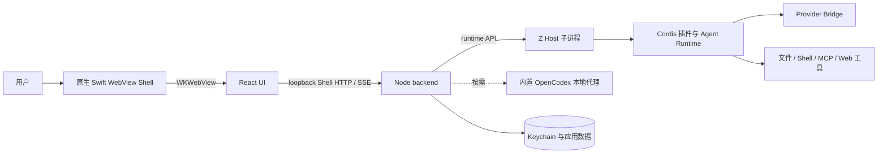

# TaskWeaver

TaskWeaver 是面向软件研发的多智能体 macOS 桌面应用。应用使用原生 Swift 窗口承载 React 界面，页面通过仅绑定本机 loopback 的 Shell HTTP 桥调用内嵌 Node 后端；Z Runtime 和 TaskWeaver 维护的 OpenCodex 代码随应用打包。

## 架构概览



| 路径 | 职责 |
| --- | --- |
| `apps/macos/TaskWeaverShell/` | 原生 Swift 窗口、WKWebView、应用内 Node 后端生命周期与工具栏 |
| `src/` | React 桌面界面与 Shell HTTP 桥客户端 |
| `apps/macos/TaskWeaver/` | macOS 应用元数据与签名权限配置 |
| `backend/` | Node 后端、IPC handler、聊天、权限、模型与编排服务 |
| `contract/channels.mjs` | React UI 与后端之间的 IPC 契约唯一来源 |
| `packages/runtime/` | Z Host Cordis 运行时与 `@taskweaver/*` 能力包 |
| `packages/provider-bridge/` | 模型 Provider Bridge 与供应商适配 |
| `vendor/opencodex/` | 随 TaskWeaver 打包的 OpenCodex 维护版本 |

OpenCodex 本地代理和 Z Host 会作为受 TaskWeaver 管理的子进程运行；OpenCodex 已包含在安装包中，用户不需要另行下载或全局安装。

正式应用通过 WKWebView 加载随包 React 页面，并由 Swift 壳启动本机 Node 后端。浏览器开发仍由 `pnpm run dev:browser` 启动，使用同一套 Shell HTTP 桥。

## 环境要求

- macOS
- Node.js `>=22.18`
- pnpm `11.7.0`（版本见根目录 `package.json`）
- Xcode Command Line Tools（构建 Swift 壳时需要）

## 安装与开发

```bash
pnpm install --frozen-lockfile
pnpm run dev             # Swift 壳 + React 界面与开发版 Node 后端
pnpm run dev:browser     # Web UI 浏览器调试
```

完整构建与 macOS 打包（React UI 由原生 WebView 壳承载）：

```bash
pnpm run build
pnpm run app             # 构建原生 .app
pnpm run install:app     # 构建并安装 Swift 壳 + React 界面的 .app
pnpm run app:dmg         # 生成 .app、ZIP 与 DMG
```

## 检查与测试

```bash
pnpm run check:ipc       # 校验 IPC 契约与生成物
pnpm run lint            # 对 backend、contract、src、脚本和 runtime 执行 ESLint
pnpm run typecheck       # TypeScript 项目引用检查
pnpm run test:integration
pnpm run test:all        # 根级回归测试集合；部分 Host 用例需要先生成 runtime 产物
pnpm run test:dsh-unit   # runtime Vitest 单元测试
pnpm run test:dsh-e2e    # runtime E2E 测试
```

`pnpm run dev:browser` 和 `pnpm run test:ui` 用于 Web UI 本地开发及隔离验证，不作为正式桌面运行入口。

## 架构与开发规范

- 系统进程边界、通信协议、安全边界和 IPC 域见[架构文档](docs/architecture.md)。
- Runtime 包族入口见 [`packages/runtime/README.md`](packages/runtime/README.md) 及各族 README。
- 仓库内 Agent 执行约定见 [`AGENTS.md`](AGENTS.md)。
- 第三方来源和许可见 [`THIRD_PARTY_NOTICES.md`](THIRD_PARTY_NOTICES.md) 与各 package 的许可证文件。
- 自有化阶段验收记录见[执行进度](docs/自有化总计划-执行进度.md)。
