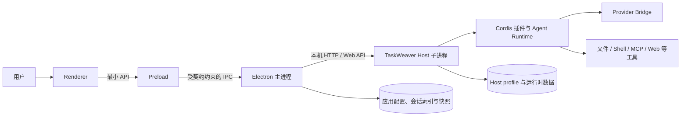

# TaskWeaver

TaskWeaver 是一款面向软件研发的多智能体桌面应用，包含 Electron 界面、独立 Host 运行时、模型 Provider Bridge，以及按能力装配的插件包。桌面打包目标为 macOS；Windows 暂不支持。

## 架构概览

论文「系统设计」章节可直接引用下图；IPC 域、安全边界与包族说明见 [架构文档](docs/architecture.md)。



| 路径 | 职责 |
| --- | --- |
| `src/` | React 界面（会话、编排、设置、终端） |
| `electron/` | 主进程、preload、IPC handler 与桌面集成 |
| `packages/runtime/` | Host Cordis 运行时与各 `@taskweaver/*` 能力包 |
| `packages/provider-bridge/` | 多供应商模型桥接与 Cursor 等适配 |
| `vendor/taskweaver-z-runtime/` | 打包用 Host 部署产物（由 `build:z-runtime` 生成） |
| `scripts/` | 构建、契约生成与回归测试入口 |

## 环境要求

- macOS
- Node.js `>=22.18`
- pnpm `11.7.0`（版本见根目录 `package.json`）

## 安装与开发

```bash
pnpm install --frozen-lockfile
pnpm run dev
```

开发模式会启动 Vite renderer 和 Electron。Host runtime 与 provider bridge 使用独立的构建入口；需要验证完整运行时构建时运行：

```bash
pnpm run build:app
pnpm run build:host
pnpm run build:dsh-chat-registry
```

`pnpm run build` 按顺序执行以上三个入口。macOS 应用的 DMG/ZIP 打包使用 `pnpm run app:dmg`。

## 检查与测试

```bash
pnpm run check:ipc       # 校验 IPC 契约、生成的 preload 与 TS 类型
pnpm run lint            # 对应用、脚本和 runtime 执行零警告 ESLint
pnpm run typecheck       # Electron/renderer TypeScript 项目引用检查
pnpm run test:integration
pnpm run test:all        # 根级脚本测试集合；部分 Host 用例需要先生成 runtime 产物
pnpm run test:dsh-unit   # runtime Vitest 单元测试
pnpm run test:dsh-e2e    # runtime E2E 测试
pnpm run test:ui         # 隔离 Electron UI 场景，会启动本地开发服务
```

Host 部署、无密钥 mock 对话和打包应用冒烟分别由 `test:runtime-deploy`、`test:keyless-e2e` 和 `test:packaged-app-launch` 覆盖。运行它们前请先按对应脚本要求准备 runtime 或应用产物。

## 架构与开发规范

- 系统分层、通信协议、安全边界和 IPC 域见[架构文档](docs/architecture.md)。
- Runtime 包族入口见 [`packages/runtime/README.md`](packages/runtime/README.md) 及各族 README。
- 仓库内 Agent 执行约定见 [`AGENTS.md`](AGENTS.md)。
- 第三方来源和许可见 [`THIRD_PARTY_NOTICES.md`](THIRD_PARTY_NOTICES.md) 与各 package 的许可证文件。
- 自有化阶段验收记录见[执行进度](docs/自有化总计划-执行进度.md)；完整总计划作为本任务附件保存，不放入仓库。
