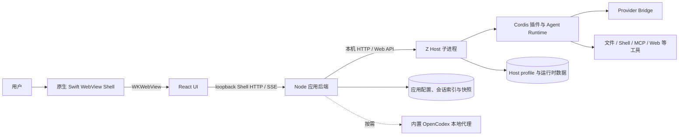

# TaskWeaver 系统架构

本文记录当前仓库的进程边界、运行时组合方式、IPC 契约和安全模型，供开发、维护与论文第 3–4 章引用。包的具体 API 以各包 README、类型定义和实现为准。

## 1. 进程与请求路径

**Swift Shell** 负责 macOS 窗口、WKWebView 承载、工具栏和 Node 后端生命周期；会话、设置等产品界面统一由 **React UI** 提供。React 通过仅绑定 `127.0.0.1` 的 Shell HTTP / SSE 桥调用 **Node 应用后端**。后端管理 Host 生命周期、桌面权限、应用存储和契约 handler，并编排模型目录、权限、Git worktree 与多 Agent DAG 等服务。**Z Host 子进程** 运行独立的 Cordis Runtime，处理 Agent 会话、模型请求和工具执行。后端与 Host 使用绑定到 `127.0.0.1` 的本机 API。

OpenCodex 的 TaskWeaver 维护版本位于 `vendor/opencodex/`，并包含在原生安装包内。后端按需运行其本地代理，因此用户无需另行下载或安装 OpenCodex；代理和 Z Host 是由应用管理的子进程。

正式桌面和浏览器开发共用 React UI 与 Shell HTTP 桥。桌面壳启动本机后端并加载随包的 React 静态页面；浏览器开发仅由 `pnpm run dev:browser` 显式启用开发桥，并校验 loopback、Host 和开发 Origin。

Cursor、Antigravity 等适配代码由 `packages/provider-bridge/` 维护。Host 从 `TASKWEAVER_BRIDGE_TRANSPORT` 指向的已编译模块装载内置桥接实现；请求凭据由主进程从安全存储解析后，以受限的 secret 环境变量传入 Host。模型目录里的凭据引用与真实密钥分开保存。

## 2. Host 运行时组合与包族

Host 使用 pnpm workspace 管理的 `@taskweaver/*` 包。Cordis 提供插件生命周期、依赖注入和上下文；profile/preset 决定当前会话实际加载哪些插件。能力包按接口、实现与消费者拆分，避免 UI 或工具直接依赖某个运行时实现。

| 包族 | 职责 |
| --- | --- |
| `core`、`cordis`、`preset`、`bundle` | 插件运行基础、Agent/Session API、预设和运行时组合 |
| `llm`、`bridge`、`provider-bridge` | 模型服务抽象、统一 Bridge 协议及供应商适配 |
| `fs`、`shell`、`subprocess`、`sandbox`、`terminal` | 文件、命令、子进程、约束执行和交互终端 |
| `session`、`session-query`、`storage`、`spill`、`attachment` | 会话事件与持久化、检索、存储和附件 |
| `context`、`skill`、`compaction`、`memory` 相关插件 | 项目规则、技能、上下文整理和记忆能力 |
| `subagent`、`workflow`、`jobs`、`plan`、`goal` | 子 Agent、工作流、后台任务和计划状态 |
| `interaction`、`host`、`api`、`sdk`、`acp` | 用户审批、Host API、远程调用与自动化接入 |

完整包族目录见 [`packages/runtime/README.md`](../packages/runtime/README.md)，桌面后端位于 `backend/`，IPC 契约位于 `contract/`，运行时包位于 `packages/runtime/`。

## 3. IPC 契约表

`contract/channels.mjs` 是 React UI 到桌面后端 invoke 通道、事件订阅与桥接方法的唯一契约来源。Shell 桥接与 TypeScript 定义都从此契约生成；handler 在各 `register-*-ipc.mjs` 中实现。`pnpm run check:ipc` 校验生成物、通道注册与 UI 调用。

| IPC 域 | 代表通道 | 责任 |
| --- | --- | --- |
| `backend` | `backend:ready` | handler 注册完成后的就绪握手 |
| `app` | `app:getState`、`app:setWorkspace` | 窗口应用状态、会话列表、工作区和会话操作 |
| `chat`、`tasks` | `chat:send`、`chat:cancel`、`tasks:approvePlan` | 消息流、会话统计、任务运行与计划审批 |
| `models`、`bridge`、`pricing`、`portfolio`、`usage` | `models:list`、`bridge:login`、`pricing:sync`、`usage:getReport` | 模型目录、OAuth、能力路由目录、定价和用量 |
| `workspace`、`worktree` | `workspace:gitStatus`、`workspace:createManualGitCommit`、`worktree:diff` | 工作区信任、Git 检查点、差异和隔离运行合并 |
| `permission`、`sandbox`、`userQuestions` | `permission:respondPrompt`、`sandbox:getEffective` | 审批、权限审计、沙箱状态和用户问答 |
| `mcp`、`webSearch` | `mcp:catalog`、`mcp:startGitHubOAuth`、`webSearch:testSearch` | Host MCP 工具目录、GitHub 授权及网页搜索设置 |
| `terminal`、`jobs`、`memory`、`preferences`、`github` | `terminal:create`、`jobs:runNow`、`memory:get` | 终端、定时任务、记忆、偏好与 GitHub 查询 |

通道名称和类型会随 `channels.mjs` 更新；以上列举的是接口域与代表调用，不代替该契约表。当前事件订阅也由该表定义，例如聊天流、模型目录更新、审批提示、终端输出和沙箱模式变化。

## 4. 安全边界

- Swift 壳仅承载 React UI 并管理后端进程；React 只通过受限的 Shell HTTP 桥访问后端，不直接访问 Node API。
- 浏览器开发桥仅在显式开发模式下启动；只监听 loopback，校验 Host 与 Origin，并限制 JSON 请求体。
- Host 通过有效权限档位和工具策略约束文件、Shell、MCP 与外部请求。只读、工作区可写和完全访问对应不同 Host 权限；应用规则与 Host 沙箱不是同一安全边界，界面偏好不能替代 Host 策略。
- 文件工具使用声明的工作区与读写范围。高风险 Git 改动由隔离 worktree 和检查点提供恢复能力；检查点不会成为授权绕过手段。
- Provider 密钥由系统安全存储管理。进程只收到所需的 secret 环境变量，普通模型配置只保存凭据引用；日志和诊断内容需脱敏。
- 工作区指令、hooks 和 skills 都是数据输入，遵循信任状态与对应安全策略，不因内容自称系统指令而提高权限。

## 5. 多 Agent DAG 与用量

Node 后端的 `orchestration-service` 保存计划、执行跟踪和审批状态；子任务经 Host 创建 Agent 并用独立会话/工作区范围执行。DAG 的依赖关系决定并行度和节点启停；需要用户修改计划、批准写入或恢复运行时走持久化状态和显式审批，不将模型回复文本当作审批结果。每个节点记录可复核的执行证据和结构化结果，汇总后返回对话 UI。会话执行本身由 Host runtime 管理，二者通过 Host API 与应用服务衔接。

模型用量由 Host 统计并由应用读取；应用侧按日期、模型和 provider 保存聚合桶，不写入会话 ID 或逐次调用明细。路由评测、DAG trace 和汇总指标可作为论文实验数据，但应绑定代码 revision、配置快照和测试环境。

## 6. 隔离 UI 自验证

`tool-ui-verify` 只接受 `data-testid` 或精确 ARIA 角色/名称，不提供任意 CSS、URL、命令或外部应用控制。每轮 prompt 的 UI 验证策略由后端读取工作区信任与用户偏好后显式传入 Host；字段缺失、仓库不匹配或策略服务不可用时关闭工具。首次运行沿用用户审批。

Playwright 驱动使用独立 `userData` 和临时 Host profile，不继承用户 API key 或 OAuth token；会话设时限，关闭或超时会结束隔离的开发 UI / 后端进程。macOS 原生辅助功能兜底默认关闭，并限制在隔离进程的目标窗口内。`pnpm run test:ui` 执行已命名场景并保存失败截图、ARIA 快照和 trace。

## 7. 文档与代码的事实边界

本文描述的是当前代码结构。规划中的构建、部署、性能和系统级测试必须由实际运行结果确认；源码存在或静态检查通过不等于打包产物已验收。分阶段完成情况和限制记录在[总计划执行进度](自有化总计划-执行进度.md)。
